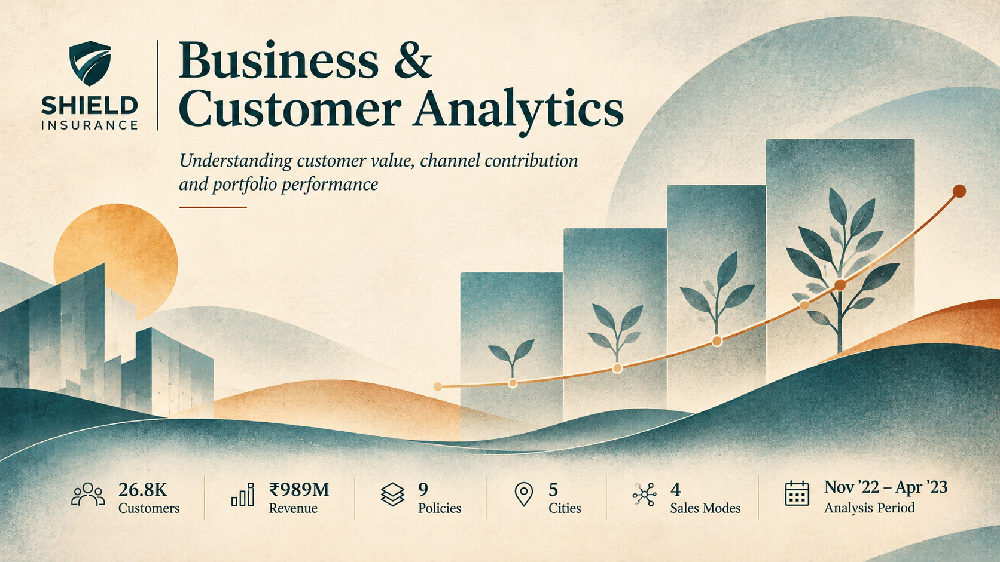
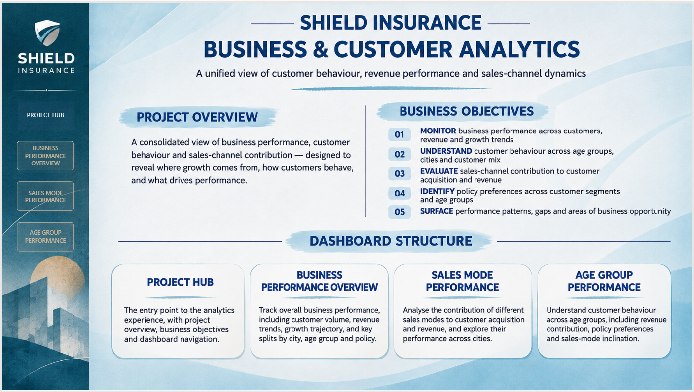
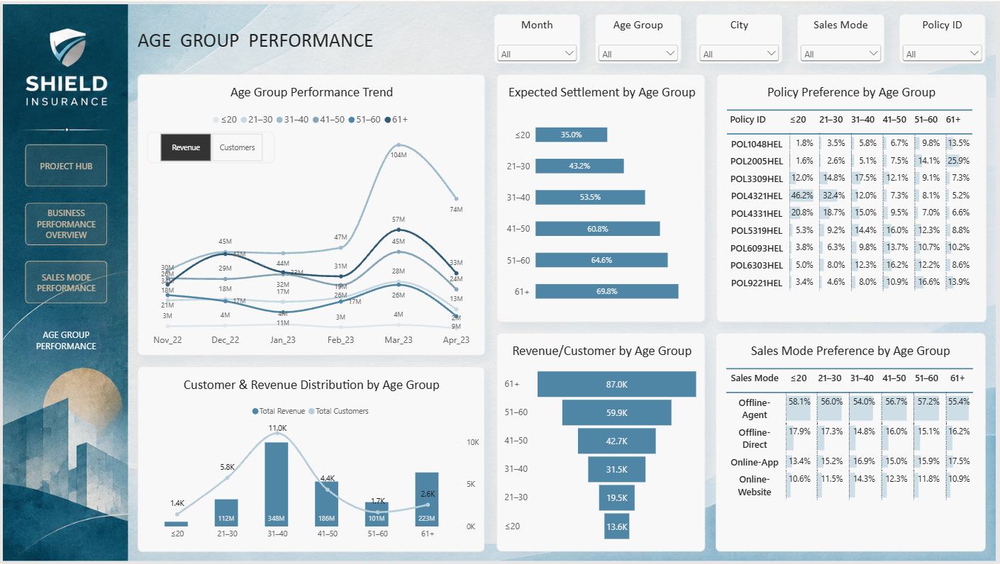

# SHIELD INSURANCE --- BUSINESS & CUSTOMER ANALYTICS



<p align="center">
  <a href="https://app.powerbi.com/view?r=eyJrIjoiOGZkMTQ3ZDctYjhlZS00ZjgwLTliNGItYWRmNWQ0MTVmMDBhIiwidCI6ImM2ZTU0OWIzLTVmNDUtNDAzMi1hYWU5LWQ0MjQ0ZGM1YjJjNCJ9&pageName=64fcee9000a502600694"><strong>View the Live Power BI Dashboard →</strong></a>
</p>

------------------------------------------------------------------------

## ■ Why This Project Matters

Insurance performance is not driven by a single metric.

Customer volume, premium revenue, customer value, policy preference,
sales-channel contribution and expected settlement can tell very
different stories when viewed separately. A business may have a large
customer segment that contributes less revenue, a smaller segment that
generates substantially higher customer value, or a sales channel that
dominates both acquisition and revenue.

This project was designed to bring those signals together into one
analytical view.

The objective was to understand:

> **Where does business performance come from, how does customer value
> vary across segments, which channels and policies contribute most, and
> where are the clearest areas for business attention?**

The resulting Power BI report moves from overall performance into
**customer segmentation, channel contribution, policy concentration,
geographic mix and age-linked value**.

------------------------------------------------------------------------

## ■ The Business Questions

The analysis was structured around five practical questions:

1.  **How is the insurance business performing across customers, revenue
    and growth trends?**
2.  **Which customer age groups contribute the most customers and
    revenue?**
3.  **How does customer value vary across age groups, cities and sales
    modes?**
4.  **Which sales modes and policies contribute disproportionately to
    revenue or customer volume?**
5.  **What performance patterns should the business investigate, protect
    or act upon?**

These questions deliberately move beyond descriptive reporting.

The goal is to connect:

``` text
Business Performance
        ↓
Customer Segmentation
        ↓
Revenue & Customer Value
        ↓
Channel / Policy / City Analysis
        ↓
Performance Patterns
        ↓
Business Action
```

------------------------------------------------------------------------

## ■ Data at a Glance

The analysis is built around a dimensional Power BI model covering
insurance premium transactions, customer attributes, policies, dates and
an age-based settlement reference.

| Attribute | Detail |
|---|---|
| **Analysis period** | November 2022 -- April 2023 |
| **Customer records** | 26,841 |
| **Premium transaction records** | 26,841 |
| **Policies** | 9 |
| **Sales modes** | 4 |
| **Cities** | 5 |
| **Primary transaction table** | `fact_premiums` |
| **Customer dimension** | `dim_customer` |
| **Policy dimension** | `dim_policies` |
| **Date dimension** | `dim_date` |
| **Settlement reference** | `age_based_settlement` |
| **Analytical platform** | Microsoft Power BI |

### Core Business Fields

The model supports analysis across:

-   customer and demographic attributes,
-   age and age groups,
-   city,
-   policy,
-   sales mode,
-   transaction date,
-   final premium amount,
-   expected settlement percentage.

The central revenue field is:

`fact_premiums[final_premium_amt(INR)]`

The analysis uses this transaction-level premium amount to evaluate
**revenue, revenue mix and revenue per customer**.

------------------------------------------------------------------------

## ■ Analytical Approach

The project was built as a business-analysis workflow rather than as a
collection of independent visuals.

### 01 --- Establish the Business Baseline

The first layer establishes the overall business position through:

-   total customers,
-   total revenue,
-   daily customer growth,
-   daily revenue growth,
-   monthly revenue movement.

This creates the baseline against which the remaining analysis is
interpreted.

### 02 --- Segment the Customer Base

Customers are analysed across age groups to understand how customer
concentration changes across the portfolio.

The dashboard uses:

-   ≤20
-   21--30
-   31--40
-   41--50
-   51--60
-   61+

This allows customer volume and revenue contribution to be compared side
by side rather than treating the customer base as one homogeneous
population.

### 03 --- Measure Customer Value

Customer count alone does not explain commercial importance.

The analysis therefore uses **Revenue / Customer** to identify where
customer value is concentrated across:

-   age groups,
-   sales modes.

This helps distinguish high-volume segments from high-value segments.

### 04 --- Evaluate Sales-Channel Contribution

The four sales modes are compared through:

-   customer mix,
-   revenue mix,
-   monthly performance,
-   city-level contribution,
-   revenue per customer.

This provides a view of both channel scale and channel economics.

### 05 --- Examine Policy and Geographic Concentration

Policy and city analysis is used to identify:

-   policies with high revenue contribution relative to customer share,
-   high-volume / lower-revenue policies,
-   cities where customer and revenue concentration are strongest,
-   city × sales-mode contribution patterns.

### 06 --- Add Expected Settlement Context

Expected settlement is analysed across age groups using the age-based
settlement reference table.

The purpose is not to label an age group as inherently risky, but to
provide an additional business context alongside customer value and
portfolio composition.

------------------------------------------------------------------------

## ■ What the Analysis Found

### 01 --- The largest customer segment is not the highest-value segment

The **31--40** age group is the largest customer segment, representing
**41.16% of customers** and **35.1% of revenue**.

However, revenue per customer increases substantially with age:

  Age Group     Revenue / Customer
  ----------- --------------------
  ≤20                       ₹13.6K
  21--30                    ₹19.5K
  31--40                    ₹31.5K
  41--50                    ₹42.7K
  51--60                    ₹59.9K
  61+                       ₹87.0K

The **61+ segment generates more than six times the revenue per customer
of the ≤20 segment**.

**Why it matters:** customer volume and customer value are telling
different stories. Portfolio strategy should therefore distinguish
between the segments that provide scale and the segments that provide
higher economic value.

------------------------------------------------------------------------

### 02 --- Revenue is highly concentrated in a small number of policies

Three policies stand out strongly:

-   **POL2005HEL:** 7.33% of customers → **32.78% of revenue**
-   **POL1048HEL:** 6.21% of customers → **16.97% of revenue**
-   **POL9221HEL:** 8.64% of customers → **12.97% of revenue**

Together, these policies represent roughly **22% of customers but nearly
63% of revenue**.

At the other end, several policies carry substantially higher customer
volume than revenue contribution.

**Why it matters:** policy performance should not be evaluated only by
customer volume. Revenue concentration indicates where commercial
performance is disproportionately dependent on a smaller part of the
portfolio.

------------------------------------------------------------------------

### 03 --- Offline-Agent remains the core sales channel

**Offline-Agent** contributes:

-   **55.7% of revenue**
-   **55.4% of customers**

It is the leading sales mode across the portfolio and maintains a
relatively consistent contribution across cities.

**Why it matters:** the agent channel is currently the core acquisition
and revenue engine. Digital channels represent an opportunity for
gradual expansion, but the existing channel should not be treated as
replaceable without evidence.

------------------------------------------------------------------------

### 04 --- Customer value is relatively close across sales modes

Revenue per customer is:

-   **Online-App:** ₹37.4K
-   **Offline-Agent:** ₹37.0K
-   **Online-Website:** ₹36.5K
-   **Offline-Direct:** ₹35.9K

Online-App leads, but the differences are relatively modest.

**Why it matters:** digital channels show value potential, but the
evidence supports a measured scaling strategy rather than assuming that
digital acquisition is automatically more valuable.

------------------------------------------------------------------------

### 05 --- Customer and revenue concentration are geographically aligned

**Delhi NCR** contributes **41.01% of customers** and **40.6% of
revenue**.

**Mumbai** contributes **23.96% of customers** and **24.2% of revenue**.

Together, the two cities account for roughly **65% of customers and
revenue**.

**Why it matters:** the strongest geographic concentrations are also
commercially aligned. Protecting these markets while identifying
targeted opportunities in lower-contribution cities is more defensible
than treating every market equally.

------------------------------------------------------------------------

### 06 --- Expected settlement increases consistently across age groups

Expected settlement rises across the age groups:

-   ≤20 --- **35.0%**
-   21--30 --- **43.2%**
-   31--40 --- **53.5%**
-   41--50 --- **60.8%**
-   51--60 --- **64.6%**
-   61+ --- **69.8%**

**Why it matters:** this provides an additional context for evaluating
age-linked portfolio economics alongside customer value and revenue
contribution.

------------------------------------------------------------------------

### 07 --- March shows a pronounced revenue spike

Monthly revenue moves from:

**₹132M → ₹156M → ₹141M → ₹143M → ₹264M → ₹154M**

from November 2022 through April 2023.

March therefore represents a clear spike rather than a continuation of
the preceding trend.

**Why it matters:** the next analytical question is not simply whether
March was strong, but **which policy, city, age group or sales mode
drove the increase and whether that driver is repeatable**.

------------------------------------------------------------------------

## ■ From Evidence to Decision

The findings suggest four broad strategic themes:

### GROW

**Higher-value customer segments and digital channels**

Older customer groups demonstrate substantially higher revenue per
customer, while Online-App shows the highest revenue per customer among
sales modes.

### OPTIMIZE

**High-volume / lower-revenue policies**

Several policies contribute significant customer volume without
comparable revenue contribution. These warrant deeper review of pricing,
product positioning and cross-sell potential.

### SUSTAIN

**Offline-Agent and core geographic markets**

Offline-Agent remains the dominant channel, while Delhi NCR and Mumbai
represent the largest concentrations of both customers and revenue.

### INVESTIGATE

**March revenue spike**

The March increase should be decomposed by policy, city, age group and
sales mode before assuming that the performance is structurally
repeatable.

The analytical principle is:

> **Protect the core. Understand the value. Optimize the gaps.
> Investigate the exceptions.**

------------------------------------------------------------------------

## ■ Business Recommendations

### 01 --- Build a differentiated strategy for higher-value customer segments

Use age-linked customer value to identify opportunities for targeted
products, cross-sell and retention initiatives, while evaluating these
opportunities alongside expected settlement economics.

### 02 --- Protect the agent channel while gradually scaling digital

Offline-Agent is currently the dominant acquisition and revenue channel.
Digital channels should be expanded progressively, with customer value
monitored to ensure growth is economically comparable.

### 03 --- Review high-volume / low-revenue policies

Investigate whether lower revenue contribution is driven by pricing,
product positioning, premium structure or limited cross-sell
opportunity.

The evidence supports review and optimization --- **not automatic
discontinuation**.

### 04 --- Prioritize investment using geographic concentration

Continue protecting the strongest markets, particularly Delhi NCR and
Mumbai, while using lower-contribution cities as targeted opportunities
for expansion rather than applying a uniform strategy.

### 05 --- Investigate the March revenue spike

Decompose the March increase across policy, city, age group and sales
mode to identify whether a repeatable commercial driver exists.

------------------------------------------------------------------------

## ■ Dashboard / Report Architecture

The final Power BI report contains four pages.

| Page | Purpose |
|---|---|
| **Project Hub** | Business context, objectives and report navigation |
| **Business Performance Overview** | Overall business performance, growth trends and customer/revenue mix |
| **Sales Mode Performance** | Channel contribution, customer/revenue mix and sales-mode economics |
| **Age Group Performance** | Age-linked customer behaviour, value, policy preference and sales-mode preference |

The presentation flow is deliberately structured as:

> **Context → Business Performance → Channel Contribution → Customer
> Segmentation → Evidence → Action**

------------------------------------------------------------------------

## ■ Dashboard Preview

### 00 --- Project Hub



The entry point to the analytics experience, establishing the project
context, business objectives and dashboard structure.

### 01 --- Business Performance Overview


The overall business view covering customers, revenue, daily growth,
monthly performance and customer/revenue concentration across policies,
age groups and cities.

### 02 --- Sales Mode Performance


The channel-focused view covering sales-mode trends, revenue and
customer mix, city-level channel contribution and revenue per customer.

### 03 --- Age Group Performance



The customer-segmentation view covering age-group trends, expected
settlement, revenue per customer, policy preference and sales-mode
preference.

------------------------------------------------------------------------

## ■ Technical Approach

### Data Model

The model is structured around `fact_premiums` as the central
transaction table.

```text
age_based_settlement
        │
        │ 1:*
        ▼
  dim_customer ────── 1:* ──────► fact_premiums ◄────── 1:* ────── dim_date
                                      ▲
                                      │
                                      │ 1:*
                                dim_policies
```

The core model relationships are:

-   `age_based_settlement[age]` → `dim_customer[age]` --- **1:* **
-   `dim_customer[customer_code]` → `fact_premiums[customer_code]` ---
    **1:* **
-   `dim_policies[policy_id]` → `fact_premiums[policy_id]` --- **1:* **
-   `dim_date[date]` → `fact_premiums[date]` --- **1:* **

The `age_based_settlement` table is connected to `dim_customer` through
age and provides the age-level settlement reference used by the
expected-settlement calculation. It is **not directly connected to
`fact_premiums`**.


### Power Query

Power Query was used to prepare and structure the source data for
analysis, including:

-   data-type handling,
-   field standardization,
-   customer and policy dimension preparation,
-   date-table preparation,
-   analytical field creation.

### DAX & Analytical Logic

The measure layer supports:

-   business KPIs,
-   daily growth,
-   month-over-month comparison,
-   revenue and customer mix,
-   revenue per customer,
-   age-group analysis,
-   sales-mode analysis,
-   expected settlement analysis,
-   policy and geographic comparisons.

The focus was on creating **decision-oriented measures**, rather than
reproducing raw calculations in the dashboard.

### Analytical Design

The report combines:

-   dimensional data modeling,
-   customer segmentation,
-   time-based analysis,
-   revenue/customer analysis,
-   cross-dimensional filtering,
-   policy and channel comparison,
-   business-oriented visual storytelling.

The mandatory analytical features were incorporated into the report,
including the key business KPIs, age-group segmentation and the Revenue
/ Customer trend switch.

------------------------------------------------------------------------

## ■ Data Source & Privacy

This project was developed as part of a **project-based learning
engagement with AtliQ Technologies**, using the insurance business
dataset provided for the project.

The underlying dataset and Power BI source file are kept **private and
are not included in this repository**.

The repository is intended to demonstrate the analytical approach,
business interpretation, dashboard design and technical implementation
without redistributing the underlying source data.

------------------------------------------------------------------------

## ■ Tools & Skills

**Power BI** --- interactive reporting, visual analytics and business
storytelling\
**Power Query** --- data preparation, transformation and
standardization\
**DAX** --- KPI measures, time-based calculations and analytical
metrics\
**Data Modeling** --- dimensional modeling, relationships and analytical
grain\
**Data Analysis** --- customer segmentation, revenue analysis, channel
and policy analysis\
**Business Analytics** --- evidence-based interpretation and business
recommendations\
**Git & GitHub** --- documentation and portfolio publication

------------------------------------------------------------------------

## ■ Author

**Debanjan Biswas**\
Data Analyst \| Excel \| SQL \| Power BI \| Python

**Email:** <bishwasdebanjan99@gmail.com>\
**LinkedIn:**
[linkedin.com/in/debanjan-biswas-2ab011148](https://www.linkedin.com/in/debanjan-biswas-2ab011148/)

------------------------------------------------------------------------

## ■ Project Perspective

This project demonstrates an approach to analytics that starts with the
**business decision**, not the visual.

The objective was to move through:

> **Business Problem → Analytical Framework → Evidence → Interpretation
> → Action → Communication**

The value of the project lies in deciding **which signals matter, how
they should be structured, what the evidence means, and what the
business should do with it.**

A strong analytics solution should therefore go beyond:

> *"What happened?"*

It should also ask:

> **Where did it happen? Why does it matter? What pattern should the
> business investigate? What action follows from the evidence?**

That is the analytical role this project is designed to demonstrate.

> **Understand the business. Segment the customer. Measure value. Find
> the concentration. Turn the evidence into action.**

------------------------------------------------------------------------

::: {align="center"}
### Customer Value → Revenue → Channel Contribution → Portfolio Concentration → Business Action

**Built with Power BI**
:::
